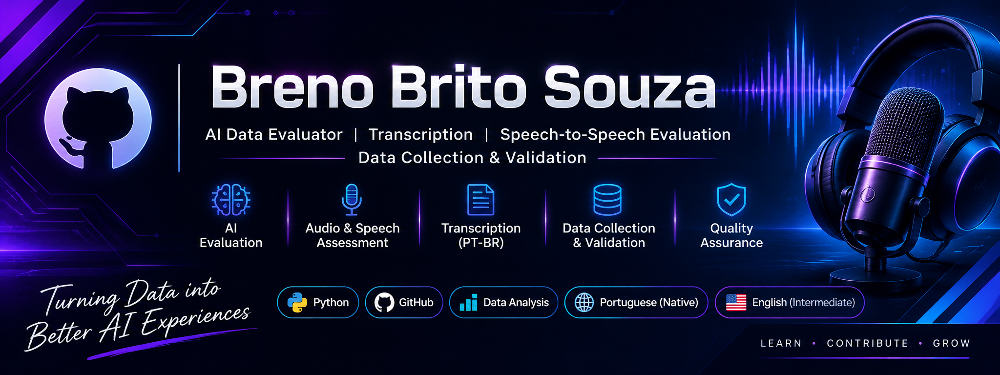

Breno Brito Souza

AI Data Evaluator | Portuguese Transcription | Speech-to-Speech Evaluation | Data Collection

Professional Summary

I am a Brazilian professional interested in Artificial Intelligence, data quality, language evaluation, and speech technologies.

I have practical experience with data collection and validation, AI response evaluation, Portuguese audio transcription, and speech-to-speech quality assessment.

I focus on accuracy, attention to detail, critical thinking, and following project-specific guidelines.

Core Skills

- AI Response Evaluation
- Speech-to-Speech (S2S) Evaluation
- Audio Quality Assessment
- Brazilian Portuguese Transcription
- Timestamping and Speaker Identification
- Data Collection and Validation
- Data Annotation and Quality Assurance
- Model Comparison
- Guideline Compliance
- Critical Thinking and Problem Solving

## Technical Skills

Professional Experience

Outlier AI

- Accepted for the Aether Speech-to-Speech Quality Screener – Portuguese.
- Focus on evaluating conversational speech quality and model responses.

TELUS Digital

- Data collection and validation involving visual information about establishments.
- Field photo collection and data quality checks.

Appen / CrowdGen

- Participation in Portuguese AI data projects.
- Calibration and production activities.

Portfolio Projects

1. AI Response Evaluation

Demonstration of structured AI response evaluation, model comparison, and quality analysis.

[View Project →](https://github.com/BrenoAzuos/ai-response-evaluation)

2. Portuguese Audio Transcription

Examples of Brazilian Portuguese transcription, timestamping, speaker identification, and annotation.

[View Project →](https://github.com/BrenoAzuos/portuguese-audio-transcription)

3. Data Collection & Validation

Demonstration of data organization, validation criteria, error detection, and quality control.

[View Project →](https://github.com/BrenoAzuos/data-collection-and-validation)

4. Speech-to-Speech Evaluation

Demonstration of audio quality assessment, naturalness, pronunciation, fluency, and model comparison.

[View Project →](https://github.com/BrenoAzuos/speech-to-speech-evaluation)

Education

- Professional High School Qualification in Massage Therapy.
- Bachelor's Degree in Business Administration – In Progress.

Languages

- Portuguese: Native
- English: Intermediate – Developing professional communication skills.

Professional Approach

I value consistency, accuracy, analytical thinking, adaptability, and continuous learning. I am interested in contributing to AI training and evaluation projects that improve language models and speech technologies.

## Contact & Availability

- **Location:** Salvador, Bahia, Brazil
- **Work Preference:** Remote Opportunities
- **Availability:** Open to International AI Projects
- **Areas of Interest:** AI Evaluation, Data Annotation, Portuguese Transcription, Speech-to-Speech Evaluation.

### Contact

- **Email:** brenosousabrito@gmail.com
- **GitHub:** [BrenoAzuos](https://github.com/BrenoAzuos)
- 
---

This portfolio includes original demonstrations created for professional presentation. Examples do not disclose confidential client information or proprietary project materials.
